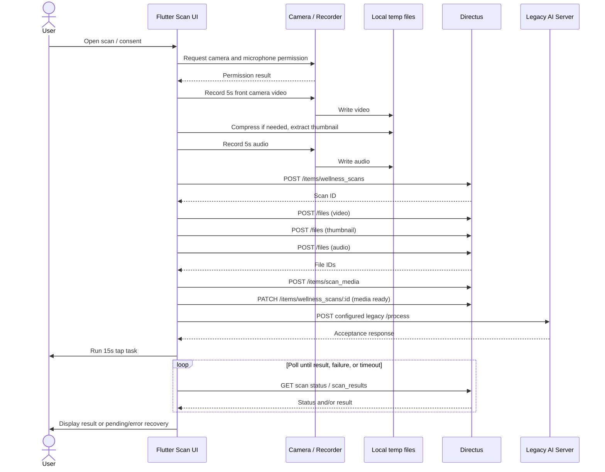

# Wellar Flutter Complete System Audit

Audit date: 2026-10-14. Scope: local source and checked-in project artifacts only. No app execution, network requests, dependency installation, tests, or backend runtime inspection was performed for this audit. Line references below refer to the files at the audited revision and should be rechecked if source changes.

## 1. Executive Summary

The app has 70 Dart files under `lib/screens` and a broad workforce, organization, request, reporting, notification, subscription, and scan feature set. The scan flow is implemented in `lib/screens/scan_flow_impl_normalized.dart`, orchestrated by `ScanFinalizeService`, and backed by `ScanService`.

The current scan sends media and lifecycle records to Directus (`/files`, `/items/wellness_scans`, `/items/scan_media`, `/items/scan_results`) and separately triggers a legacy AI server `POST /process` configured by `AI_SERVER_URL`. Default AI host is a legacy `conntinuity-ai-server` host. No V2 client, V2 base URL, or V2 contract implementation was found in Flutter source. Thus V2 is not integrated in the audited source. The client does not contain the AI server implementation, and the local `backend/` directory contains Directus extensions and Google exchange artifacts, not the standalone V2 backend.

The capture uses a five-second front-camera video, five-second audio recording, and a 15-second tap/reaction-style focus task. Video target settings are 1280x720, 30 fps, nominal 3.5 Mbps, H.264/MP4; these are requested/processing targets and not proof every device produces them. Video is uploaded before audio in the finalize path, then a media relation is written, the scan is marked ready, and the legacy processing trigger is called. Results are polled from Directus. The flow has substantial retry and recovery logic, but no durable background job or resumable upload is established by source.

Critical concerns: legacy service routing; potentially costly polling/query fan-out; sensitive local media and temporary retention; assessment/result labels that imply readiness/fatigue conclusions without scientific validation evidence in this repository; tenant-scope correctness depends on Directus permissions/contracts; and one active-session UI flow needs testing under app lifecycle interruptions. No capacity conclusion can be drawn from source inspection.

## 2. Audit Scope and Evidence

Reviewed `lib/`, `pubspec.yaml`, tests, Android/iOS manifests and project configuration, selected local `backend/` source and Directus schema/docs. Existing audit documents were treated as secondary context and not as proof where source was available. No external service was contacted. This is static source analysis, not runtime verification. Source reference style: `path:line`.

## 3. Flutter Architecture

- Entry/init: `lib/main.dart:25-88`; portrait-only orientation, secure session and language load before `runApp`; Firebase/push initialization deferred after first frame and skipped on web.
- UI: Material `MaterialApp`, custom Navigator key, `SplashScreen` home, imperative `Navigator.push`/replacement, deep links, custom transition helpers. No centralized named-route table or GoRouter found.
- State: Riverpod `ProviderScope`, providers and state in `lib/state/app_providers.dart`; mutable singleton services; `ChangeNotifier` language controller; `StateProvider`/`FutureProvider` for session-derived state and data.
- Services/repositories: service classes under `lib/services`, primarily Directus/Dio via `DirectusClient`; scan is a distinct service with additional direct Dio AI call.
- Models: hand-written JSON parsing under `lib/models`; no generated serialization detected. `ScanResult.fromJson` tolerates aliases and nullable metrics (`lib/models/scan_result.dart`).
- DI: Riverpod provider bindings, but service instances mostly global singletons (`ScanService.instance`, `DirectusClient.instance`, etc.).
- HTTP: Dio centralized Directus client; direct AI request uses a separate Dio instance in `scan_service.dart`; push/auth SDK traffic also exists.

## 4. Dependency and Service Inventory

Key packages from `pubspec.yaml`: Flutter localization, Dio, Riverpod, secure storage, image_picker, camera, record, video_compress, get_thumbnail_video, path_provider, connectivity_plus, app_links, Firebase Core/Auth/Messaging, Google Sign-In, local notifications, PDF, open_filex, url_launcher, google_fonts. No application-level mock implementation found in production services; unit/widget tests use fakes/mocks as applicable.

Services include auth/session, organization/workspace/member identity, business center/profile, scan/finalize/readiness, request/invitation, reports/export, notifications/push, alert/activity/audit, subscription, workforce and role-specific operations. External systems evidenced: Directus, legacy AI server, Firebase Cloud Messaging/Core/Auth and Google Sign-In/mobile token exchange. PDF generation and file opening are local SDK features. No analytics vendor endpoint identified in source review.

## 5. Complete Navigation/Screen Catalog

Inventory count is 70 Dart screen files (`lib/screens/**/*.dart`), not a count of every stateful subview/dialog. Navigation is imperative and feature-specific; screens are commonly reached from role shells, dashboard cards, bottom navigation, lists and deep-link/push handlers.

Screen files (all discovered): `activity_screen.dart`, `admin_scan_requests_screen.dart`, `alert_detail_screen.dart`, `analytics_screen.dart`, `auth_intent_screen.dart`, `auth_welcome_screen.dart`, `business_members_manage_screen.dart`, `business_profile_summary_screen.dart`, `business_profile_wizard_screen.dart`, `company_dashboard_screen.dart`, `company_readiness_results_screen.dart`, `employee_home_screen.dart`, `employee_requests_screen.dart`, `export_screen.dart`, `forgot_password_screen.dart`, `history_screen.dart`, `home.dart`, `home/audit_logs_view.dart`, `home/create_request_view.dart`, `home/history_view.dart`, `home/home_dashboard.dart`, `home/home_screen.dart`, `home/permission_view.dart`, `home/requests_view.dart`, `hr_compliance_screen.dart`, `hr_home_screen.dart`, `hr_requests_screen.dart`, `hr_workforce_screen.dart`, `insights_screen.dart`, `invite_screen.dart`, `login_screen.dart`, `manager_home_screen.dart`, `manager_requests_screen.dart`, `manager_scan_requests_screen.dart`, `manager_team_screen.dart`, `mobile_auth_screen.dart`, `notifications_screen.dart`, `onboarding_screen.dart`, `organization_invitation_screen.dart`, `owner_company_screen.dart`, `owner_home_screen.dart`, `owner_hr_ops_screen.dart`, `owner_more_screen.dart`, `owner_reports_screen.dart`, `owner_requests_screen.dart`, `owner_scan_history_screen.dart`, `owner_workforce_screen.dart`, `pricing_screen.dart`, `profile_screen.dart`, `public_entry_screen.dart`, `public_home_screen.dart`, `push_diagnostics_screen.dart`, `register_screen.dart`, `report_metric_detail_screen.dart`, `request_details_screen.dart`, `requests_screen.dart`, `role_based_shells.dart`, `scan/scan_premium_components.dart`, `scan_details_screen.dart`, `scan_flow_impl_normalized.dart`, `scan_request_details_screen.dart`, `scan_request_open_screen.dart`, `splash_screen.dart`, `subscription_management_screen.dart`, `subscription_paywall_screen.dart`, `subscription_success_screen.dart`, `verification_screen.dart`, `wellness_check_screen.dart`, `workspace_access_screen.dart`, `workspace_picker_screen.dart`.

This file list is the screen/module inventory, not evidence that every screen is reachable in every account configuration. Role-based shells and access prerequisites gate destinations. Reusable dialogs, bottom sheets, permission cards, error states and scan step views are embedded in screen files and are catalogued in Section 6 and the scan trace.

## 6. Screen-by-Screen Functional Documentation

Screen structure is feature-oriented as catalogued above. Important actual journeys:

| Journey/screen group | Entry/prerequisite and actions | Data/network/state effects | Evidence |
|---|---|---|---|
| Startup, public entry, onboarding | `SplashScreen` routes based on session; public entry/home and onboarding provide unauthenticated paths | session from secure storage; providers refreshed after first frame/resume | `main.dart`; `screens/splash_screen.dart`, `public_entry_screen.dart`, `onboarding_screen.dart` |
| Login/register/verification/reset | login, registration, Google/mobile auth, verification and forgot password screens | `AuthService` and mobile Google exchange; session persisted securely | `screens/login_screen.dart`, `register_screen.dart`, `mobile_auth_screen.dart`, `verification_screen.dart`, `forgot_password_screen.dart`; `services/auth_service.dart` |
| Workspace access/picker/invitation | authenticated account selects/creates/accepts workspace; invite deep link opens invite screen | organization, invitation, membership services; active workspace context and secure workspace selection | `workspace_access_screen.dart`, `workspace_picker_screen.dart`, `organization_invitation_screen.dart`, `invite_screen.dart` |
| Employee home and requests | role shell/home, request list/detail, accept/decline or open assigned scan | request service and scan-request routes; pushes can open request | `employee_home_screen.dart`, `employee_requests_screen.dart`, `requests_screen.dart`, `request_details_screen.dart`, `scan_request_open_screen.dart` |
| Scan | permission gate → video → audio → focus task → finalize/poll/result | camera/mic, Directus media/scan endpoints, legacy AI process, Directus result reads; see Section 10 | `scan_flow_impl_normalized.dart`, `scan_finalize_service.dart`, `scan_service.dart` |
| History and details | home/history/owner scan history lists and scan detail/result navigation | Directus scan and result reads; provider cache is in-memory and invalidated on navigation/resume | `history_screen.dart`, `home/history_view.dart`, `owner_scan_history_screen.dart`, `scan_details_screen.dart`, `state/app_providers.dart` |
| Manager/HR/owner operations | role-specific dashboards, teams/workforce, requests, reports, company, compliance | corresponding `*_ops_service`, organization, report and request services; tenant/profile filters passed in some operations | `role_based_shells.dart`, `manager_*`, `hr_*`, `owner_*`, `company_*` screens |
| Profile/settings/notifications | profile, language, subscription, notification inbox/diagnostics; push taps route to request | Directus profile/subscription/notifications; secure language/session; Firebase push | `profile_screen.dart`, `subscription_*`, `notifications_screen.dart`, `push_diagnostics_screen.dart`, `push_notification_service.dart` |
| Analytics/insights/exports/activity/audit | summaries, metrics, export creation/download, activity/audit history | Directus; local PDF generation/opening where applicable | `analytics_screen.dart`, `insights_screen.dart`, `report_metric_detail_screen.dart`, `export_screen.dart`, `activity_screen.dart`, `home/audit_logs_view.dart` |

The app has a global error widget (restart guidance; exception details only in debug), loading/empty/error widgets, connectivity banner, and skeleton/processing components. Exact per-button and every embedded dialog behavior is owned by each screen source; they are not all centrally declared. See endpoint inventory and screen source index for call chains. The repository contains widget and service tests listed in Section 21; they prove test intent only, not device/runtime outcomes.

## 7. Complete API Endpoint Inventory

Requests are generated from Dart call sites, not runtime captures. Directus base URL is `DIRECTUS_URL`, default `https://dash.conntinuity.com`; optional fallback base URL is `DIRECTUS_FALLBACK_URL` (`lib/config/app_config.dart`). The shared client adds bearer auth and retry/refresh logic. Dynamic IDs, filters and selected fields are assembled at call time. This inventory lists endpoint families (including dynamic resource IDs); exact request bodies are built in the referenced methods.

**Scan-specific route inventory:**

| Method and route | Purpose/caller | Auth, payload and handling |
|---|---|---|
| `GET /items/wellness_scans` | history/status/list (`ScanService.fetchHistoryTimeline`, `fetchHomeData`, lookups) | Directus bearer; user/profile filters, sorting, fields, limits; shared Dio retry/auth refresh |
| `POST /items/wellness_scans` | create scan (`createWellnessScan`) | bearer; user/workspace/request linkage, scan metadata; response ID parsed |
| `GET /items/wellness_scans/:id` | status/result relation lookup | bearer; selected fields; errors normalized/logged |
| `PATCH /items/wellness_scans/:id` | lifecycle flags/status/media-ready/failure update | bearer; lifecycle fields; retry behavior per shared client |
| `POST /files` | audio, video and thumbnail upload (multipart) | bearer; multipart `file`; per-video Dio timeout 45s connect/3m send/3m receive; video limit 80 MiB, preferred 5 MiB; retry policy includes delays 2s/5s in upload path; no demonstrated resumable chunk protocol |
| `POST /items/scan_media` | link uploaded asset IDs to scan | bearer; IDs/metadata assembled by finalize service |
| `GET /items/scan_results` | result by scan ID and result polling/history | bearer; filters and field selections; repeated requests per policy |
| `GET /items/scan_results/:id` | direct result lookup | bearer; selected fields |
| `PATCH /items/scan_results/:id` | observed mutation/fallback path in scan service | bearer; conditional compatibility handling |
| `POST <AI_SERVER_URL>` (default URL ends `/process`) | legacy AI process trigger from `ScanService.triggerAiProcessing` | separate Dio, payload assembled from scan/media identifiers; 15s connect/send, 30s receive; accepts response status/body; no V2 JWT contract evidenced |
| `GET /items/business_profile_members/:id` | member identity/association lookup in scan service | bearer; tenant/member context is Directus-side |

The app polls Directus and does not have a separate explicit V2 status endpoint. Uploads and result reads go to Directus, processing trigger goes to the legacy AI URL.

**Other Directus endpoint families:** `/auth/login`, `/auth/logout`, `/auth/refresh`; `/users` and `/users/:id`; `/items/<collection>` and `/items/<collection>/:id` for profiles, memberships, workspaces, invitations, requests, notifications, alerts, activity/audit, reports/exports, subscriptions, plans and business entities; `/files` for report exports; `/fields/:collection/:field`; `/wellar/workspaces/context`; custom `/wellar/...` organization/workspace and push-related routes. Collections/routes are assembled across `auth_service.dart`, `organization_service.dart`, `request_service.dart`, `member_identity_service.dart`, `notification_service.dart`, `report_service.dart`, `subscription_service.dart`, `business_center_service.dart`, `*_ops_service.dart`, and `protected_push_subscription_api.dart`. Operations include GET, POST and PATCH; DELETE/other methods should be confirmed against the individual call sites before relying on backend contract. Query filters, limits, selected fields and bodies vary by method; no single universal DTO applies.

**Other external traffic:** Firebase Core/Messaging SDK initialization, FCM token retrieval and subscriptions, Google Sign-In/Firebase Auth flows, and Google mobile token exchange endpoint configured by `GOOGLE_MOBILE_EXCHANGE_BASE_URL` + `GOOGLE_MOBILE_EXCHANGE_PATH`. Firebase SDK traffic is implicit and not enumerable as ordinary Dio routes from Flutter source. `PushSubscription` sync/revoke paths are configurable/feature-gated (`ENABLE_PUSH_SUBSCRIPTION_WRITES`, default false). No app analytics endpoint was identified.

Endpoint counts depend on whether dynamic collection routes, auth refresh retries and implicit SDK requests are counted as distinct operations. No misleading single count is claimed here; enumerate route templates above and audit the listed service call sites for the complete current contract.

## 8. Authentication and Session Lifecycle

`Session.init()` reads access/refresh tokens, user identity/display fields and pending invite token from `FlutterSecureStorage` (`lib/state/session.dart`). Login/exchange sets secure values; logout clears them. `DirectusClient` adds `Authorization: Bearer ...`, handles 401 by a single-flight refresh and retry, tries JSON refresh-token mode then cookie mode, and can retry on transient connection errors; configured fallback base URLs may be tried. Default Directus timeouts are connect 15s, receive 20s; inspect `directus_client.dart:11-16`. Refresh endpoint is `/auth/refresh`. Google mobile exchange is a separate configured service. Tenant/workspace selection is distinct from JWT and stored/managed via workspace services; client-side role checks are not proof of backend authorization.

## 9. Data Models and State Management

Handwritten models include `ScanResult`, `HistoryEntry`, `UserProfile`, `Organization`, `RequestItem`, `NotificationItem`, reports, plans/subscriptions, workspace/member and activity/audit models. `ScanResult` maps snake_case and camelCase aliases, nullable scores/metrics and fallback labels. Providers cache Future results in process; latest scan is merged optimistically into in-memory history providers, then provider invalidation re-fetches remote data. No durable scan queue/offline database or persisted result cache was found. Most screens use local `setState`; scan flow uses one large stateful widget and explicit enum stages.

## 10. Complete Scan Lifecycle (Stages 0–10)

Entry is the self-service scan action or assigned request scan. Main state machine is `ScanFlowStep { intro, consent, permissions, video, audio, focus }` (`scan_flow_impl_normalized.dart:30`).

### Stage 0 — Preconditions

User must be authenticated for Directus scan creation and workspace/company linkage. Scan flow checks camera and microphone permissions; workspace/association is resolved during scan creation. No remote feature flag, eligibility/cooldown enforcement, or scientific validation precondition is evidenced in this scan widget. Assigned request ID/source are passed through. Subscription/role gates may affect entry points but are not a demonstrated scan-level guarantee.

### Stage 1 — Opening scan

Widget `initState` initializes state and lifecycle observer; no continuous capture starts until permission/capture actions. Intro/consent and permission step shown. Permission preparation checks camera and microphone via camera package/recorder (`_preparePermissions`, `_ensureAudioPermission`). Errors keep user on permission step with retry; no camera/mic means cannot proceed. On dispose controllers/recorder are disposed. App lifecycle callback can invalidate an interrupted capture session, especially video-to-audio gap.

### Stage 2 — Capturing media

Camera video: five seconds, preferred front lens, H.264/MP4, desired 1280x720, 30 fps, nominal 3,500,000 bitrate (`:75-86`, `:248`). Camera plugin device support can alter actual output; no enforced actual resolution/FPS proof. After video, compression/inspection through `video_compress` IO implementation; it may skip recompression when already within profile, else compress at 720p/30fps with audio excluded and `deleteOrigin:false`. Failure can fall back to source file or show retake error. Audio: five-second recording with `record` plugin; concrete codec/sample-rate/channel settings should be read from recorder config at `:1660+`; file is a plugin temporary output. Thumbnail bytes generated from video. Captured media stored in plugin/cache/temp paths; names and exact lifetime are device/plugin-dependent. No explicit scan photo capture path.

### Stage 3 — Reaction/vigilance task

After capture/finalization begins, `_startFocusTask` runs 15 seconds (`:2013+`, `_focusDuration=15`). UI presents a tap target/task and records local timing/count data via Dart timers and tap handlers. This is a simple interaction task; code does not establish a validated PVT protocol, controlled display/refresh latency, calibrated timestamp source, or scientific validation. Wall-clock timestamps appear in diagnostic logs; stopwatch/timer/tap timing may be affected by scheduler, frame rendering, thermal/device load and backgrounding. No claim of scientific reaction-time accuracy should be made. Payload includes task data only if assembled in finalize payload; exact fields in `ScanFinalizeService` and scan metadata must not be interpreted as validated measurements.

### Stage 4 — Preprocessing

Video may be compressed and thumbnail extracted; audio is recorded locally. No on-device face detection, face alignment, audio feature extraction, ML inference or biometric scoring was found in Flutter. Integrity checks include file existence/length and upload-size handling. Payload/media metadata assembled in `ScanFinalizeService`; temporary source files are not explicitly deleted as a complete cleanup routine. Some logs were made privacy-safe, but video compressor IO logs print file paths/sizes and error content (`utils/video_compress_io.dart`), a privacy/debug risk.

### Stage 5 — Upload

Finalize service uploads video, thumbnail and audio sequentially (inspect `scan_finalize_service.dart` upload sequence; `scan_flow_impl_normalized.dart:1937+` invokes workflow after capture). Each goes to Directus `/files` as multipart with bearer auth. Video upload has distinct long Dio timeout, max size 80 MiB and preferred threshold 5 MiB. Retry exists for upload paths with bounded short delays; no upload resume/chunk offset or durable retry queue. Progress UI shows preparation/finalizing steps rather than a demonstrated byte-level progress stream. If upload or link creation fails, workflow stops and UI offers retry/retake; already uploaded files may remain orphaned.

### Stage 6 — Server submission

Client creates `/items/wellness_scans` before final media workflow, linking user/profile/request and preferred capture metadata (`scan_flow_impl_normalized.dart:1875-1884`; `ScanService.createWellnessScan`). After files, writes `/items/scan_media`, patches scan media-ready, and triggers the configured AI server `/process`. No explicit idempotency key or server deduplication guarantee found. Client guards duplicate local workflow starts in memory (`:1937+`), which is lost on process restart. The AI backend selection is `AI_SERVER_URL`, default legacy AI host; not V2.

### Stage 7 — Background processing

Client contract knows the trigger response (acceptance expected as HTTP 202 in `ScanFinalizeService`) and Directus statuses such as pending/media_ready/processing/in_progress/completed/failed. The Flutter project has no standalone V2 server source. The local Directus schema and artifacts may describe flows, but cannot prove live runtime worker/inference behavior. Do not infer queues, ML stages, storage actions or capacity from the client.

### Stage 8 — Result retrieval

After focus task, `_resolvePostFocusResult` loops through scan/result lookups and status checks (`:2224-2505`). Uses `ScanResultPollingPolicy` with initial/regular/mid interval and total timeout; code also has a completed consistency window and fallback direct result ID lookup. Requests are sequential, chiefly `GET /items/scan_results` filtered by scan ID and scan status GET. On timeout, pending/failed states display retry/return UI. Result reads use Directus shared HTTP retry/refresh; poll policy is not push/stream.

### Stage 9 — Result interpretation

`ScanResult` parses readiness/risk/state, scores, confidence, model version, baseline and face/voice/reaction metrics. UI `scan_result_display.dart`, `scan_details_screen.dart`, dashboard and history map them to labels/chips/summaries/actions. `ScanService` normalizes states including Stable, Low Focus, Elevated Fatigue and High Risk. Null score/metrics remain nullable; fallback state is “Review needed” in model parser, but no comprehensive V2 `insufficient_evidence` schema mapping was established. No client scientific cutoff validation found in this audit. These labels can be consequential; repository contains no evidence proving clinical/scientific validation or deployment calibration.

### Stage 10 — After result

Result screen replaces flow; latest result is added to Riverpod in-memory override and history is refreshed. Request-linked scan completion updates request status after checking current request (`_completeRequestAfterResultReady`, `:2545+`). Media deletion is not a guaranteed flow step; retake clears references and calls controller stop/dispose, but no verified server asset deletion. Process death loses widget/task state; restart loads session and remote history, with no local scan resume protocol. Repeated scan is available via restart/retake paths; no cooldown verified.

## 11. Scan Sequence Diagram

The order above reflects service orchestration; some video preparation runs asynchronously while later UI steps occur. No V2 participant is shown because none was found in the current path.

## 12. Hidden Background Operations

`AutoRefreshGate` invalidates home, scans and history providers at initial frame and on resume; route observer invalidates on push/pop/replace (`main.dart`). Firebase initialization and push registration are deferred; push notification tap can route to request screen. Connectivity provider listens to plugin stream and rechecks on resume. Deep links parse invite tokens and store them securely. None of these is a durable scan processing/background upload mechanism. Firebase native SDK network traffic is implicit.

## 13. Failure and Recovery Paths

| Failure | Observed response / remaining concern |
|---|---|
| Permission denied/device unavailable | Permission screen/retry; device capability errors cannot be fully tested statically. |
| Bad lighting/quality | Guidance UI; no verified automatic quality/face-quality score gate. |
| Unsupported/corrupt video | compress/thumbnail errors and retake/failure state; actual plugin behavior device-specific. |
| Cancel/back | pop confirmation/flow exit; local state discarded, uploaded objects may persist. |
| App background during capture | lifecycle observer invalidates capture gap and stops recorder/controller where active; process kill is not recoverable. |
| Offline during upload | bounded retry then failure; no persistent queue/resume. Partial uploads may remain. |
| Auth expires mid-upload | Directus client retries refresh for its client; separate AI Dio does not share Directus auth interceptor. A media upload may succeed before later trigger fails. |
| Upload succeeds / submission fails | local finalize failure UI, retry path; duplicate/orphan risk without idempotency/deletion. |
| Duplicate trigger | in-memory workflow guard and retry policy; no backend idempotency proof. |
| Queue full/worker failure | mapped error/status can surface if server sends it; exact legacy backend semantics unavailable. |
| Poll timeout/result absent | policy timeout and pending/retry UI; result read polling can generate repeated Directus load. |
| Reopen result | history/detail fetch by Directus IDs; access depends on Directus authorization and tenant scoping. |

## 14. Media Capture and Temporary Storage

Video is captured as MP4, 5 seconds, preferred 720p/30fps; transcoding uses video_compress and may create a second temp file. Audio capture is 5 seconds through `record`. Thumbnail generated locally. Multipart upload goes to Directus. Exact actual codecs, audio sample rate, bitrate, orientation on all devices, cache directory and cleanup lifetime depend on plugin/platform configuration and runtime. No explicit encryption-at-rest for plugin cache files, remote media retention policy, or guaranteed deletion is established by Flutter source. Upload max/preferred sizes are not a proof of typical payload sizes.

## 15. Results, Scores, Thresholds and Display Logic

Fields include readiness score, confidence, camera/voice confidence, task performance score, confidence drift, risk/overall state, explanation/action/summary, model version/baseline and face/voice/reaction metric maps. Parser tolerates aliases and missing metrics. No locally defined numerical threshold was identified that independently validates scientific interpretation. Labels are backend-provided or normalization/fallback logic; a UI category is not evidence of clinical validity. V2 `insufficient_evidence`/null target behavior is not contract-matched in app source and requires explicit mapping and display review.

## 16. Device Performance and UX Bottlenecks

Startup blocks on secure session/language reads but defers Firebase; orientation and error handlers are set before UI. Camera initialization, five-second recording, compression and file IO may be dominant client latency/battery/memory costs. Compression runs through plugin/platform implementation; exact CPU/thread behavior and UI jank require device profiling. Upload can wait up to three minutes send/receive for video. No byte-level progress guarantee. Repeated per-scan result lookups/history may add perceived wait. Camera hardware, thermal throttling, codec support, OS scheduling, storage and network vary. No benchmark was run.

## 17. Backend and Network Performance Risks

Large independent device uploads can create Directus file-storage and legacy AI request bursts; client source gives no throughput or concurrency capacity. History scans may request result details in loops, creating N+1 request patterns (`scan_service.dart:190-254`). Polling policies multiply request volume by active scans. Shared client retries/fallback can amplify load during outages. Separate AI Dio has its own timeout and no shared auth refresh. Backend queue/worker/Directus limits and external identity limits are unknown. No capacity claim is supportable from source.

Future non-production plan: instrument a representative device matrix; measure startup, permissions/camera warmup, capture, compression, upload bytes/duration, trigger acceptance, first result and terminal result separately. Use synthetic non-biometric fixtures and isolated V2/Directus environments. Test one device at a time, then concurrency ramps with realistic media-size distributions and network shaping; include 401 refresh, disconnect/reconnect, duplicate trigger, partial upload, worker failure, queue saturation and timeout. Record p50/p95/p99, error rates, retries, bytes, server CPU/memory/queue/storage and tenant fairness. Keep identity provider load tests separate and use provider-approved sandbox quotas.

## 18. Security, Privacy and Tenant Isolation

**High:** sensitive face/video/audio are uploaded to Directus and legacy AI flow; local cache cleanup and retention are not guaranteed by client code. Define consent, retention, deletion and incident controls; verify storage encryption and access policies separately.

**High:** tenant scoping is partly supplied in client query filters/profile context, but authorization must be enforced server-side. Confirm Directus policy checks every scan, media, result and user route against tenant and subject. Client filters alone are not a boundary.

**High:** scan process is configured to a legacy AI host, so V2 data routing/privacy assumptions would be wrong if integration is presumed. Separate config per environment and document actual recipient.

**Medium:** video compression logs include local paths and potentially verbose error details (`video_compress_io.dart`); audit release logging and plugin diagnostics. `safe_debug_log` reduces some field disclosure but cannot establish all dependency logs are safe.

**Medium:** no idempotency key evidenced; retries after partial completion may duplicate scans/media/processing. Add contract-level deduplication before rollout.

**Medium:** JWTs are stored using platform secure storage; review platform backup/accessibility flags and refresh token rotation/revocation behavior. Source cannot prove OS keychain/keystore configuration in shipped builds.

**Medium:** consent screen and platform permission purpose strings require review on Android/iOS. No app analytics endpoint found; Firebase SDK telemetry must be separately inventoried/configured. KSS subjective values, if captured in a task/UI/API, must remain distinct from independently measured vigilance references; no proof of a validated pairing contract was found.

## 19. Android/iOS Platform Differences

Android manifest declares permissions/features and app metadata; iOS `Info.plist` carries camera/microphone usage descriptions and URL schemes. Flutter plugins provide camera, recorder, secure storage, Firebase, notifications and compression native implementations. Native app entry points are standard `MainActivity.kt` and `AppDelegate.swift`; no custom native scan/AI inference implementation was identified. Build configuration has debug/profile/release manifests and Gradle/Xcode settings; no comprehensive flavor matrix or environment-specific V2 configuration found. Device-level permission prompts, background behavior and codecs remain runtime verification items.

## 20. V2 Integration Gap Matrix

| Contract area | Current source evidence | Classification |
|---|---|---|
| Backend target | `AI_SERVER_URL` default is legacy `/process`; no V2 URL/client | Requires mobile change/config; not integrated |
| Auth | Directus bearer for Directus; AI trigger uses separate Dio without V2 JWT/OIDC exchange | Cannot verify compatibility; likely mobile/backend integration required |
| Media upload | Directus multipart `/files`, Directus file IDs and `scan_media` relation | Requires V2 contract decision/change if V2 expects direct object-store/V2 upload |
| Tenant/subject claims | Directus user/profile/request fields and filters | Cannot verify V2 claim mapping |
| Idempotency | in-memory duplicate guard only; no key evidenced | Requires contract and mobile change |
| Scan DTO | wellness_scans Directus item + legacy process payload | Not source-verified compatible with V2 DTO |
| Status | Directus wellness scan status polling | Requires adapter/mapping if V2 owns status |
| Results | Directus scan_results schema and legacy labels/metrics | Requires explicit V2 schema mapping; null/insufficient evidence unresolved |
| Failure codes | scan failure mapper and Directus status handling; legacy trigger exceptions | Cannot verify V2 parity |
| V2 backend implementation | No identifiable standalone V2 source in this workspace | Cannot verify server contract, capacity or actual processing |

## 21. Feature Completion Matrix

| Feature | Source status | Verification boundary |
|---|---|---|
| Role-based navigation and broad workforce features | Implemented in source | Runtime role/access coverage not executed |
| Auth/session and workspace selection | Implemented with secure storage and refresh | Provider/server policy not verified |
| Capture and scan submission | Implemented; Directus + legacy AI | No runtime device or backend test |
| Poll/result/history | Implemented with polling and provider cache | No V2 schema compatibility proof |
| Push/deep links | Implemented with Firebase/app_links | Delivery/runtime config not verified |
| Offline scan recovery | Limited retries/connectivity display | No durable resumability/queue evidenced |
| V2 integration | Not present in audited Flutter source | Standalone V2 source absent here |

Existing tests include widget/auth journey, workspace selection, organization switch, scan service projection, scan result model/display, polling policy, failure mapper and push contract/diagnostics tests under `test/`. Tests were not run by instruction.

## 22. Bugs, Risks and Technical Debt

1. Legacy AI endpoint is current scan processor selection; migration risk if deployment assumes V2.
2. N+1 result history lookup may scale poorly.
3. No durable upload/resume, idempotency or guaranteed orphan cleanup.
4. Temporary biometric media retention and debug path logging need explicit controls.
5. Large single scan widget orchestrates capture, lifecycle, finalize and polling; complex failure state increases regression risk.
6. UI readiness/fatigue labels have no local validation evidence; ensure intended use and disclaimers match evidence.
7. V2 result schema and insufficient-evidence semantics are not represented explicitly.
8. Multiple base URLs/fallback and build configuration require environment audit to prevent accidental cross-environment data routing.

## 23. Offline Verification Opportunities

Without network/API use, verify with tests/fakes: permission denied/no hardware, background/resume and capture-gap invalidation, app dispose during recording, media size boundaries, compression failure fallback, multipart ordering, partial-success orphan tracking, refresh expiry mid-upload, duplicate submit after recreated widget, polling backoff/terminal states, null and `insufficient_evidence` parsing, tenant filter construction, and no sensitive logs. Add hermetic fake Directus and fake V2 contract tests when integration DTOs exist. Device tests should use synthetic media only.

## 24. Required Future Integration and Load Tests

Before V2 release, define versioned mobile DTOs, JWT/OIDC audience/claims, tenant/subject linkage, upload ownership, idempotency semantics, lifecycle statuses, polling/backoff, result schema and explicit insufficient-evidence behavior. Test Android/iOS against a non-production V2 stack using synthetic media, contract fixtures and fault injection. Run concurrency tests only in isolated capacity-approved environments; separate upload, inference queue, result retrieval, Directus and identity-service load. Measure end-to-end and per-stage latency and resource costs; do not extrapolate capacity from client code.

## 25. Unknowns and Unverified Assumptions

- No standalone V2 backend source found; actual V2 routes, auth, queue, model, storage, capacity and failure behavior are unknown.
- Legacy AI server implementation unavailable; `/process` payload semantics beyond client assembly and acceptance are not established.
- Directus live configuration/permissions may differ from sanitized/local schema and artifacts.
- Runtime camera output, media codec details, plugin temp-file retention, compression latency and memory/battery are not measured.
- Every deeply nested dialog/button path was not runtime exercised; catalog reflects files and service calls.
- SDK-mediated Firebase/Google network requests cannot be fully enumerated from Dart endpoint literals.
- Number of route templates varies based on dynamic resource IDs and SDK internal requests; endpoint routes are grouped in Section 7 rather than presenting a false exact count.
- Source review cannot prove scientific validity, clinical safety, fairness, calibration or PVT equivalence.

## 26. Source Evidence Index

- Startup/navigation/lifecycle: `lib/main.dart:25-88`, `:90-175`, `:270+`.
- Configuration: `lib/config/app_config.dart:1-56`.
- Directus HTTP/retry/auth: `lib/services/directus_client.dart:1-127`, `:182-248`, `:331-430`.
- Session storage: `lib/state/session.dart:1-120`.
- Scan state and capture constants: `lib/screens/scan_flow_impl_normalized.dart:30-138`, `:223-280`, `:1352-1778`.
- Scan creation/finalize/polling: `lib/screens/scan_flow_impl_normalized.dart:1875-2010`, `:2013-2505`, `:2545-2600`.
- Scan endpoints/uploads/status/results: `lib/services/scan_service.dart:139-150`, `:154-290`, `:600-940`, `:950-1260`, `:1280-1558`, `:1570-1755`.
- Orchestration/retries: `lib/services/scan_finalize_service.dart:1-70`, `:300-570`.
- Scan model: `lib/models/scan_result.dart:1-140`.
- Scan display and policy: `lib/utils/scan_result_display.dart`, `lib/utils/scan_result_polling_policy.dart`, `lib/utils/scan_failure_mapper.dart`.
- Compression: `lib/utils/video_compress_io.dart`.
- Provider/data invalidation: `lib/state/app_providers.dart`; lifecycle invalidation in `lib/main.dart`.
- Push registration/routing: `lib/services/push_notification_service.dart`, `lib/services/protected_push_subscription_api.dart`, `lib/main.dart`.
- Dependencies/platform permissions: `pubspec.yaml`, `android/app/src/main/AndroidManifest.xml`, `ios/Runner/Info.plist`, `android/app/build.gradle.kts`, `ios/Runner.xcodeproj/project.pbxproj`.
- Tests: `test/scan_*_test.dart`, `test/push_*_test.dart`, `test/auth_journey_screens_test.dart`, `test/workspace_selection_policy_test.dart`, `test/organization_switch_flow_test.dart`, `test/widget_test.dart`.

## 27. Prioritized Engineering Recommendations

1. Treat legacy processing as the current integration and agree on V2 contract before changing target; add explicit environment-specific V2 config and remove ambiguity in release routing.
2. Specify auth, tenant/subject, upload, idempotency, status, result and failure DTO contracts; add contract tests with synthetic fixtures.
3. Introduce durable/idempotent scan orchestration and server-side deduplication; define cleanup for partial media upload and cancellation.
4. Reduce history N+1 fetches and tune poll cadence/backoff using measured server latency and expected concurrent scans.
5. Establish media consent, local/remote retention/deletion, log redaction, Directus object access controls and tenant isolation review.
6. Validate device capture quality/timing and measure startup/camera/compression/upload on representative Android/iOS hardware; make no PVT/scientific claims absent validation.
7. Define explicit null/insufficient-evidence rendering and distinguish self-reported KSS from independent vigilance/task outcomes.
8. Build isolated V2 load tests with staged concurrency and realistic synthetic payload sizes; derive capacity from observed server metrics, not app code.
