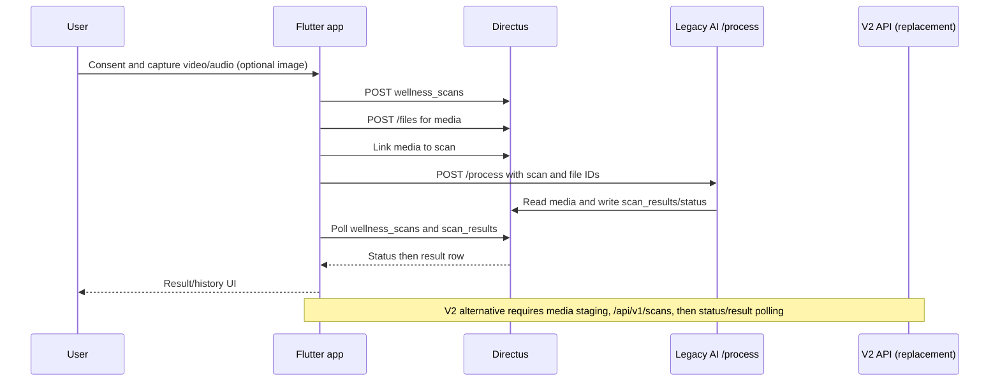

# Legacy AI integration map

Evidence policy: repository code and committed Directus exports only. Runtime deployments were not contacted. `UNVERIFIED` means this checkout does not prove the behavior. Paths are relative to the Flutter repository unless prefixed with `D:\flutter\last`.

## A. Flutter app

### Scan path, screen by screen

| Stage | Observed behavior and evidence |
|---|---|
| Consent / intro | `lib/screens/scan_flow_impl_normalized.dart` implements the scan journey and consent/introduction copy; the server scan body defaults `consentGranted=true` and sends `consent_granted` (`lib/services/scan_service.dart`, `createWellnessScan`). Exact displayed consent copy and enforcement of explicit choice: inspect screen source; the server-side requirement is UNVERIFIED. |
| Capture | The flow captures a short front-camera video and recorded audio, with permission/readiness views and retake/error states (`lib/screens/scan_flow_impl_normalized.dart`; `lib/services/scan_finalize_service.dart`). Image capture is available through `ScanService` paths, but whether the standard flow sends an image in every scan is UNVERIFIED. Exact codec and duration limits are UNVERIFIED at the app boundary. |
| Directus scan creation | `POST /items/wellness_scans` with user/workspace/member/consent/device/request/task metadata (`lib/services/scan_service.dart`, `createWellnessScan`). Directus bearer authentication is provided by `DirectusClient`. |
| Media upload | Media files are uploaded to Directus `/files`; file IDs are attached to scan media records. Video request timeouts: connect 45s, send 3m, receive 3m; maximum accepted video 80 MiB, preferred 5 MiB (`lib/services/scan_service.dart`). Prefinalization uses a 3 minute timeout and retry delays 2s and 5s (`lib/services/scan_finalize_service.dart`). Image/audio app size limits: UNVERIFIED. |
| Trigger / wait | App POSTs JSON to configured AI URL ending `/process`, with 15s connect/send and 30s receive timeout (`lib/services/scan_service.dart`). It then reads Directus scan status and polls Directus for `scan_results`; polling interval/backoff is defined by `lib/utils/scan_result_polling_policy.dart`. AI call itself is synchronous at the HTTP request boundary; scan work may continue asynchronously and app obtains final result by Directus polling. Webhook to app: none evidenced. |
| Result / save | Results are loaded from Directus `scan_results`, parsed by `ScanResult.fromJson` (`lib/models/scan_result.dart`), and displayed in scan details/history/dashboard (`lib/screens/scan_details_screen.dart`, `lib/screens/history_screen.dart`, `lib/screens/home/home_dashboard.dart`). Save/persistence is server-side Directus records; client creates scan and media rows, AI integration writes result. |

### Network contract used by app

| Call | Method and endpoint | Auth / body | Limits / error behavior |
|---|---|---|---|
| Directus scan history/status/results | GET `/items/wellness_scans`, `/items/scan_results`, with Directus filters and IDs | Directus client bearer session; query uses user/member/profile, status, date and requested fields (`lib/services/scan_service.dart`) | 401 becomes unauthenticated; 403 often returns empty history; transient network errors may return empty data. Other errors rethrow. |
| Create scan | POST `/items/wellness_scans` | JSON includes `consent_granted`, user/member/business profile, device/environment info, request source/ID, department/role snapshots and task metrics (`createWellnessScan`) | Duplicate in-progress guard checks pending/media_ready/processing/in_progress scans within 10 minutes. |
| Upload | POST `/files` multipart | Directus file field and multipart metadata; exact generated field values are created in `scan_service.dart`. | Video 80 MiB hard cap; app seeks <=5 MiB preferred. Connect 45s, send/receive 3m. |
| Legacy AI | POST configured `AppConfig.aiServerUrl` (default `https://conntinuity-ai-server.csiwm3.easypanel.host/process`) | JSON payload assembled by `triggerAiServerProcess`; request has no app Directus bearer forwarding evidenced. Exact keys are documented in JSON below. | 15s connect/send, 30s receive. Retry: UNVERIFIED. |
| Scan result read | GET `/items/scan_results` and `/items/scan_results/{id}` | Directus bearer session, filter by scan ID and user/profile | Polls Directus, not AI status endpoint. |

Environment/config names: `WELLAR_AI_SERVER_URL` (see `lib/config/app_config.dart`, `aiServerUrl`); Directus URL/session are configured by `DirectusClient` and `AppConfig`. Exact env names for Directus: UNVERIFIED from this pass. AI endpoint headers: JSON content type; AI authentication requirement/credential: UNVERIFIED. Never forward a secret in this report.

### Response fields and UI dependencies

`ScanResult.fromJson` accepts aliases. UI-visible core fields: `id`, `scan_id`, `risk_level` / `riskLevel` / `readiness_state`, `readiness_label` / `readinessLabel`, `readiness_score` / `readinessScore`, `confidence_score`, `overall_state`, `operational_summary`, `readiness_summary`, `fatigue_score`, `focus_score`, `risk_score`, `ai_model_version`, `baseline_used`, timestamp fields. Optional fields remain nullable; see `lib/models/scan_result.dart` for full field list and fallback order.

`lib/utils/scan_result_display.dart` normalizes `low_focus`, `elevated_fatigue`, `high_risk` and labels them “Low focus”, “Elevated fatigue”, “High risk”; unknown state falls back to “High risk”. `lib/screens/scan_details_screen.dart` and `lib/screens/company_readiness_results_screen.dart` render readiness/risk and score summaries. Exact score ranges/colors are sourced in those widgets and theme; numeric boundaries are UNVERIFIED here. Do not interpret confidence/readiness as clinically validated: `D:\flutter\last\ai-server\AI_ACCURACY_VALIDATION.md` says NOT EVALUATED / NOT APPROVED for consequential health or safety decisions.

### Local data, consent, other features

Capture temp/media cleanup exists in scan flow/finalization; exact delete-on-each-success/failure lifecycle is UNVERIFIED. KSS/self-report and task input are passed as task metrics by the scan creation flow; exact questions and storage field mapping: UNVERIFIED. History comes from Directus `wellness_scans` plus per-scan `scan_results` lookups (`ScanService.fetchHistoryTimeline`). Charts/aggregations are app-side projections of result/history data (`lib/services/scan_service.dart`, `lib/utils/readiness_distribution.dart`). Notifications use the notification services and push-subscription Directus extensions; not AI output webhook unless a flow states so. Offline connectivity banner exists (`lib/widgets/connectivity_status_banner.dart`); durable offline scan-result cache: UNVERIFIED.

## B. Legacy AI server

Project located at `D:\flutter\last\ai-server`. Stack: Python/FastAPI, entry `main.py`, Dockerfile and requirements (`main.py:19,43`; `Dockerfile`). Routes include GET `/`, `/health`, `/ready`, `/readiness`, POST `/baseline`, `/process` (`main.py:322,3406-3589`). Deployment port/environment values are in `Dockerfile` and `config.py`; runtime deploy configuration: UNVERIFIED. `/process` accepts multipart and/or scan metadata; exact parameters and required fields are represented by `process_scan` (`main.py:3589` onward). See Flutter body and `main.py` together for deployed contract; no live server was queried.

Authentication: `/process` auth mechanism and whether enabled in production are UNVERIFIED. `directus_client.py` has a service bearer token path to Directus, with variable names defined in `config.py`; this means server can call Directus. Flutter independently creates Directus scan/media records and calls AI. Directus flow export also contains a `WallerAi` external request calling `ai-server` (`backend/directus/docs/phase-0-directus-findings.md`, flow exports); whether active in production is UNVERIFIED.

Computation: `video.py`, `audio.py`, `vision.py`, `quality.py`, `scoring.py`, `baseline.py`, and `ml/runtime.py` implement modalities, quality gates, scoring, baseline and optional ML. `SCORING_EQUATIONS.md` documents modality weighted fusion, task subscore, model expected readiness and deductions. Runtime uses configurable local model path `ML_MODEL_PATH` default `models/latest.pt`; `REQUIRE_LOCAL_MODEL` defaults false (`config.py`). The checked-in model artifact is absent per `AI_ACCURACY_VALIDATION.md`; therefore deployed model presence/contribution is UNVERIFIED and heuristic fallback is possible. Hard-coded defaults and synthetic/test examples exist; do not treat them as proof of deployed model quality. Audit document says not evaluated/approved for consequential health/safety use.

Storage: scan results are written through `directus_client.py` to Directus; ephemeral jobs are retained 300s in `analysis_runtime.py`. Temporary media paths are used by audio/video processing; complete cleanup on every path is UNVERIFIED. Server logs use `logger.py`; request/media redaction behavior must be confirmed before production exposure. Limits/failure modes include missing model, modality quality rejection/retake, media decode errors, Directus failures, background runtime startup attempts capped at 3, job retention 300s (`analysis_runtime.py`). Measured production latency/concurrency: UNVERIFIED.

### Legacy contract examples (illustrative keys, values redacted)

Flutter-to-AI JSON shape, as assembled in `lib/services/scan_service.dart` (`triggerAiServerProcess`); the exact payload fields must be checked there before deployment:

```json
{
  "scan_id": "<Directus wellness_scans id>",
  "user_id": "<id>",
  "video_file_id": "<Directus file id>",
  "audio_file_id": "<Directus file id>",
  "image_file_id": "<optional Directus file id>",
  "task_metrics": {},
  "device_info": {},
  "environment_info": {}
}
```

AI response is a trigger/status response; durable final result is the Directus `scan_results` row, not a guaranteed inline final payload. Result row (field names evidenced by model/parser and legacy writer; values illustrative):

```json
{
  "id": "<id>", "scan_id": "<id>",
  "risk_level": "<Stable|Low Focus|Elevated Fatigue|High Risk>",
  "readiness_state": "<state>", "readiness_label": "<label>",
  "readiness_score": 0.0, "confidence_score": 0.0,
  "overall_state": "<state>", "operational_summary": "<text>",
  "readiness_summary": "<text>", "fatigue_score": 0.0,
  "focus_score": 0.0, "risk_score": 0.0,
  "ai_model_version": "<version>", "baseline_used": false
}
```

Directus flow response/persistence contract and exact AI JSON field names: UNVERIFIED without review of raw operation bodies in `backend/directus/flows/`.

## C. Directus backend

Project location: `backend/directus` in this repo. Committed schema snapshot, commit-safe permission/role exports and flow/operation exports exist. Scan-related collections include `wellness_scans`, `scan_media`, `scan_media_files`, `scan_results`, plus `scan_requests`; flow notes also mention legacy `requests` (`backend/directus/docs/legacy-collections-decision-log.md`; `backend/directus/permissions/*app-collections*`). Fields include scan IDs, status, consent, media file relation, results, user/member/profile and timestamps; full field names/types are in `backend/directus/schema/directus-schema.snapshot.json`.

Roles/policies constrain reads/writes via commit-safe exports. Precise effective live permissions: UNVERIFIED. Flow audit documents 21 flows with `accountability: all`, mail operations, external request actions, and `WallerAi` calling ai-server and creating `scan_results` (`backend/directus/docs/phase-0-directus-findings.md`). Raw flow semantics must be treated cautiously: local export is sanitized; external URLs/headers are redacted. No live Directus contacted.

App persists scan rows/media using Directus REST; legacy AI server also writes results to Directus using its service client. App reads history/results directly. Web/admin dashboards consume the same Directus collections via Flutter company/owner screens; separate web admin code in this checkout is UNVERIFIED. Auth: app session bearer to Directus; AI uses server-side Directus bearer configured by env; app-to-AI auth is UNVERIFIED. Scheduled jobs, aggregations and HR alerts consuming AI output: flow exports/docs evidence exists but exact active schedules/consumers UNVERIFIED.

## D. Gap analysis against V2

Flutter includes an explicit V2 client (`lib/services/wellar_v2_client.dart`) and V2 result screen. V2 API is `/api/v1/scans`, status `/api/v1/scans/{id}`, result `/api/v1/scans/{id}/result`; media upload accepts video/mp4 <20 MiB, JPEG <5 MiB, PCM WAV <8 MiB (`wellar_v2_client.dart`). Client timeout 20s. V2 expects staged media references and consent `{media_processing:true,research_use:false}`. The V2 result screen explicitly states V2 does not provide validated fatigue/vigilance prediction (`wellar_v2_result_screen.dart`).

| Legacy contract item | Used by | V2 equivalent | Match / Differs / Missing | Required adapter |
|---|---|---|---|---|
| POST `/process` JSON with Directus scan/file IDs | Flutter; Directus `WallerAi` | POST `/api/v1/scans` with V2 media/consent schema | Differs | Legacy facade validates existing IDs, maps consent/metadata, submits V2 scan. |
| Directus media file upload `/files` | Flutter/Directus | V2 staged media upload by modality | Differs | Bridge must fetch authorized Directus files and re-upload or provide controlled storage reference. |
| `scan_id` as Directus ID | Flutter + Directus | V2 scan ID | Differs | Persist mapping table legacy scan ID ↔ V2 scan ID. |
| `scan_results` fields `risk_level`, readiness/fatigue/focus/risk scores | Flutter and Directus | descriptive evidence/result schema | Missing semantic equivalence | Do not fabricate scores; adapter returns explicit unsupported/unavailable fields, keep legacy UI only if product permits neutral state. |
| Directus `scan_results` persistence | App history/dashboard | V2 DB result plus optional Directus sync | Differs | Compatibility writer maps only semantically supported fields; extend Directus schema or store V2 payload separately. |
| Polling Directus scan status/result | Flutter | V2 status and result endpoints | Differs | Facade updates Directus status/result or Flutter changes to V2 polling. |
| Legacy audio/video/image support | Flutter upload | V2 video/image/audio caps/formats | Differs | Validate/transcode; WAV required, cap media, return retake before acceptance. |
| Auth | Directus session / AI service credentials | V2 JWT and Directus sync credentials | Differs | Service-to-service auth translation, tenant/user binding and least privilege. |

Responsibilities table: App captures media, consent and displays results; NOT responsible for inference. Directus owns identity, tenant records, media relations, result/history access and flows; NOT responsible for model inference except orchestration. Legacy AI validates/processes evidence and writes scan result; NOT authoritative for app identity. V2 owns queued inference/evidence schema and optional Directus integration; NOT drop-in legacy contract.



